<p align="center">
  
</p>

```text
KO-YAMASAKI(7)              Research Manual              KO-YAMASAKI(7)
```

## NAME

**Ko Yamasaki** — graph algorithms student building verifiable software for graph-structured problems

## SYNOPSIS

```console
$ ko-yamasaki \
    --research graph-grammar-membership \
    --domain ttsp-graphs \
    --methods decomposition,dynamic-programming \
    --next institute-of-science-tokyo
```

## DESCRIPTION

Fourth-year undergraduate student in Intelligent Systems at **Hiroshima City University**. Incoming master's student at **Institute of Science Tokyo** in April 2027, with research interests spanning graph algorithms, graph mining, graph neural networks, and network science.

The working principle is simple: define the object precisely, implement the algorithm transparently, and keep mathematical guarantees separate from experimental evidence.

## RESEARCH

```text
SUBJECT     membership testing for graph grammars
OBJECT      two-terminal series-parallel graphs
APPROACH    structural decomposition + algorithms
STATE       undergraduate research in progress
ACCESS      private; unpublished results are not exposed
```

The current work studies how the recursive structure of TTSP graphs can support algorithms for deciding membership in graph-grammar languages. No claim is presented as complete or proved before review.

## PROJECTS

### [`graph-algorithms-lab(1)`](https://github.com/mosamosa-ko/graph-algorithms-lab)

[](https://github.com/mosamosa-ko/graph-algorithms-lab/actions/workflows/ci.yml)

```text
STRUCTURE       typed multigraphs, traversal, connectivity, S/P composition
ALGORITHMS      TTSP generation, recognition, decomposition trees, tree DP
VERIFICATION    pytest, exhaustive small instances, independent oracles
EXPERIMENTS     reproducible benchmarks + retained environment metadata
TOOLCHAIN       Python 3.11+ / Ruff / GitHub Actions / Git
```

Public and independently implemented from general graph theory and published literature. It does not contain private undergraduate-research code or data.

## METHOD

```text
definition(1)
    └── algorithm(2)
          └── typed-implementation(3)
                └── independent-checks(4)
                      └── reproducible-experiment(5)
```

## INTERESTS

```text
STRUCTURE    graph algorithms / formal graph models / decomposition
LEARNING     graph mining / graph neural networks / explainable AI
NETWORKS     network science / relational data / dynamic graphs
```

## QUEUE

```text
gnn-from-scratch(1)      [planned]  inspectable message-passing models
dynamic-graph-bench(1)   [planned]  correctness-first update benchmarks
```

These entries are plans, not completed repositories.

## SEE ALSO

[`koyamasaki.com`](https://koyamasaki.com) · [`repositories(5)`](https://github.com/mosamosa-ko?tab=repositories) · [`graph-algorithms-lab(1)`](https://github.com/mosamosa-ko/graph-algorithms-lab)

```text
KO-YAMASAKI(7)                    2026                    KO-YAMASAKI(7)
```
