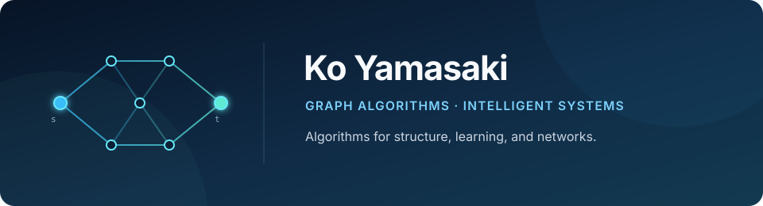

  

  <a href="https://koyamasaki.com"><strong>Website</strong></a>
  &nbsp;·&nbsp;
  <a href="https://github.com/mosamosa-ko?tab=repositories"><strong>Repositories</strong></a>

## About

I am a fourth-year undergraduate student in Intelligent Systems at **Hiroshima City University**, working on algorithms for graph-structured objects. In April 2027, I will begin graduate study at **Institute of Science Tokyo**, where I plan to pursue research in graphs and network science.

My goal is to connect rigorous algorithmic reasoning with reproducible implementations and experiments.

## Current research

### Membership testing for graph grammars on TTSP graphs

I am studying an algorithmic approach to deciding whether a two-terminal series-parallel (TTSP) graph belongs to a language generated by a graph grammar. The work examines how recursive graph structure and decomposition can support membership testing.

`Undergraduate research · in progress · private repository`

This is ongoing work. I do not present the algorithm, its correctness, or its experimental results as completed until they have been reviewed and are ready for release.

## Research projects

### [graph-algorithms-lab](https://github.com/mosamosa-ko/graph-algorithms-lab)

An independent implementation and study project on graph algorithms and TTSP networks. Its first release focuses on multigraph data structures, connectivity, series/parallel composition, TTSP generation and recognition, S/P decomposition trees, dynamic programming, exhaustive small-instance tests, reproducible benchmarks, and SVG visualization.

`Python` `pytest` `Ruff` `GitHub Actions`

**Status:** public initial release; actively developing the algorithmic core.

### Planned studies

- **`gnn-from-scratch`** — transparent implementations of message passing, GCN, GraphSAGE, and GAT, with tiny-graph checks and controlled experiments
- **`dynamic-graph-bench`** — correctness-first benchmarks for connectivity algorithms under graph updates

These are research plans, not completed repositories.

## Research interests

- **Graph Algorithms** — decomposition, recognition, dynamic programming, and structural algorithms
- **Graph Mining** — extracting interpretable patterns from relational data
- **Graph Neural Networks** — message passing, expressive power, and evaluation
- **Network Science** — structure and dynamics of complex networks
- **Explainable AI** — explanations grounded in model and data structure

## Technical approach

I aim to make algorithmic work inspectable and reproducible through:

- explicit problem definitions, assumptions, and complexity analysis;
- typed reference implementations with small, composable interfaces;
- unit tests, exhaustive checks on small instances, and independent test oracles;
- benchmarks that retain raw measurements and environment metadata;
- a clear separation between mathematical guarantees and empirical evidence.

## Current toolkit

| Area | Tools and methods |
| --- | --- |
| Programming | Python, typed package design, Git |
| Verification | pytest, exhaustive small-instance testing, reference implementations |
| Quality | Ruff, GitHub Actions, reproducible scripts |
| Theory | Graph algorithms, S/P decomposition, dynamic programming |
| Learning | Graph mining, GNNs, network science |

## Looking ahead

I am particularly interested in algorithms and learning methods that exploit graph structure while remaining understandable, testable, and useful on real network data.

  <a href="https://koyamasaki.com">koyamasaki.com</a>

